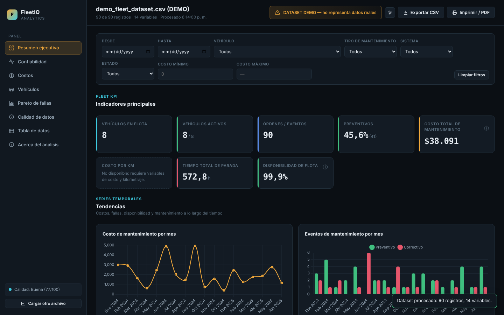
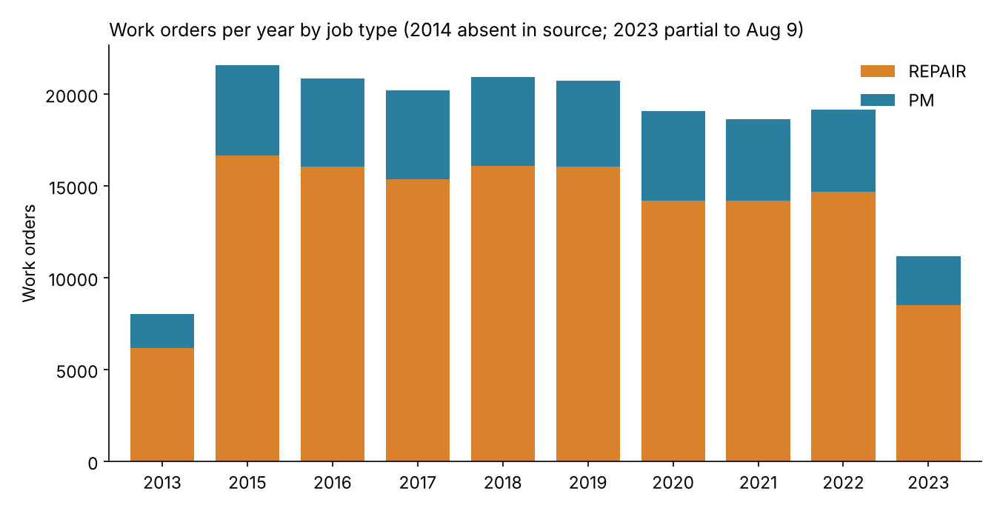
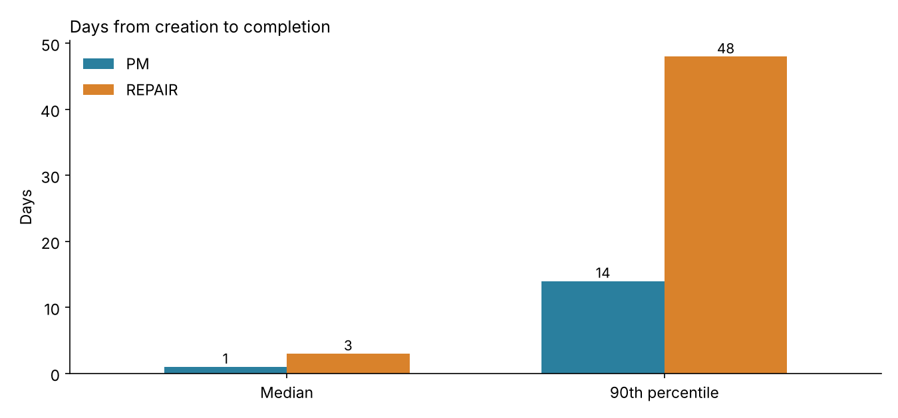
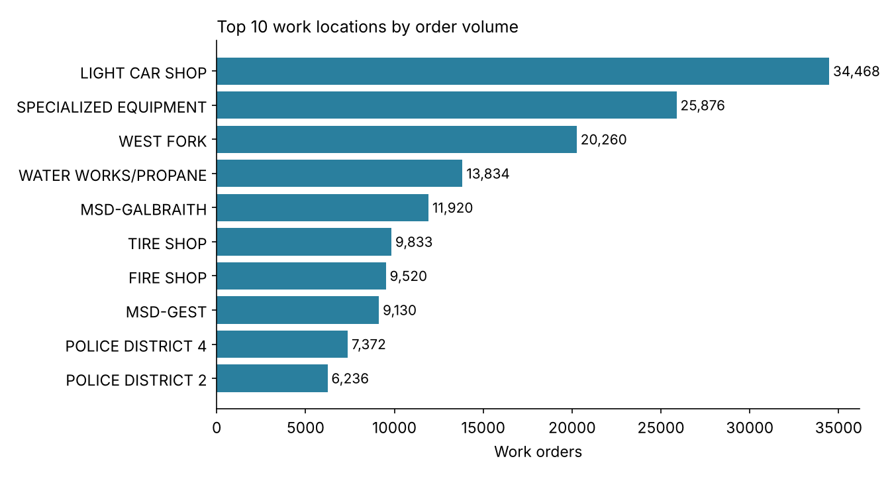
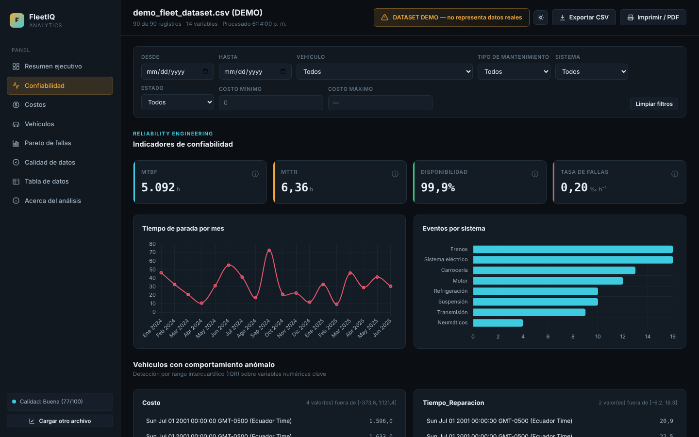
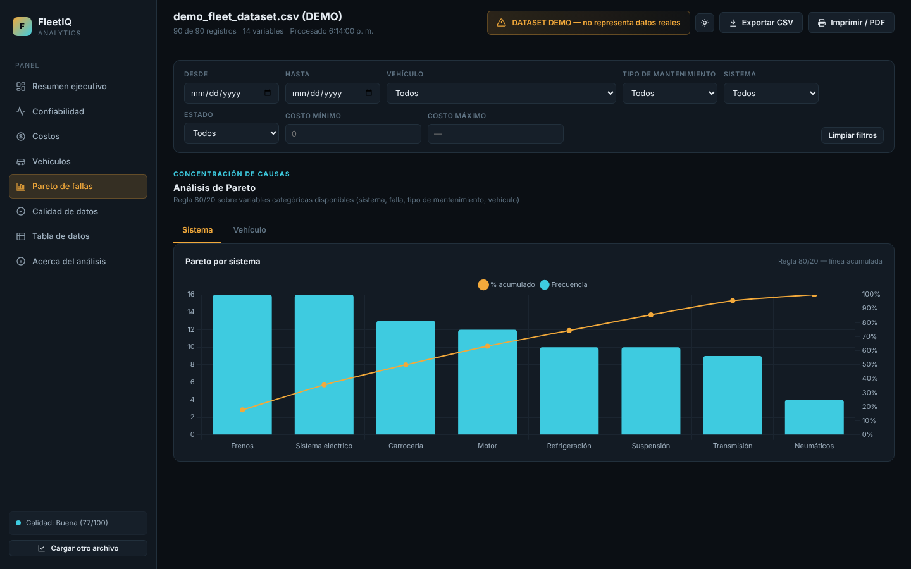
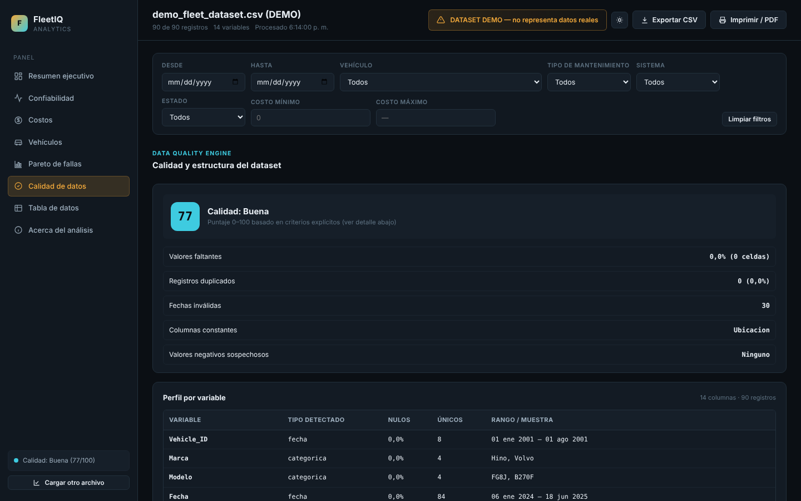

# FleetIQ — Fleet Maintenance Analytics (City of Cincinnati work orders, 2013–2023)

> A data-quality audit and exploratory analysis of **180,353 real fleet work orders**, plus **FleetIQ**: a single-file, offline dashboard I built to profile unknown maintenance datasets and compute reliability KPIs (MTBF, MTTR, availability, cost per hour/km).

**Skills shown:** data auditing and cleaning · exploratory analysis (AI-assisted) · KPI design (reliability engineering) · dashboard design (HTML/Chart.js) · documenting assumptions and limitations


*FleetIQ running on its built-in demo dataset (synthetic, clearly labelled in the app).*

---

## 1. Business question

A municipal fleet generates hundreds of thousands of work orders. Before any KPI can be trusted, an analyst has to answer:

1. Is the data usable, and what has to be fixed first?
2. How is the workload split between preventive (PM) and corrective (repair) work, and how fast is work completed?
3. Where is the workload concentrated (shops, vehicles)?

## 2. Data

| Item | Value |
|---|---|
| Source | City of Cincinnati open data portal (data.cincinnati-oh.gov) — *Fleet Preventative Maintenance & Repair Work Orders 2015–2023*. Companion dataset: [Fleet Inventory](https://data.cincinnati-oh.gov/Thriving-Neighborhoods/Fleet-Inventory/m8ba-xmjz/about_data) (asset catalogue, same Fleet Services Division) |
| Rows in file | 220,348 (30 columns) |
| Usable work orders | **180,353** (39,995 fully empty rows removed) |
| Period | 2013-01-01 → 2023-08-09 (no records for 2014; 2023 is partial) |
| Vehicles / equipment | 6,468 distinct units |

The raw 27 MB workbook is not stored here; `data/sample_5000_rows.csv` is a random sample (seed 42) with the same structure so the app and the script can be tried immediately.

## 3. Data-quality findings

| # | Finding | Impact | How it was handled |
|---|---|---|---|
| 1 | **18.2 % of rows (39,995) are completely empty** | Inflates record counts and null rates | Dropped before any metric |
| 2 | **Two column layouts coexist in one sheet.** 95.4 % of rows have values from `WARRANTY` onward offset from the header (e.g. the equipment number appears under `LABOR_HOURS`) | Cost, labour, downtime and department columns cannot be trusted as labelled | Analysis restricted to the first 17 columns, which are consistent in every row; cost/labour columns **not** used for conclusions |
| 3 | Year stored as a decimal (`2.023`, `2.02` for 2020) | Looks like a date or a decimal; trailing zero lost | Year derived from `CREATE_DATE` instead |
| 4 | Text codes inside numeric columns (e.g. `X0304` in `LABOR_HOURS`, department names in `DELAY_HOURS`) | Numeric parsing fails / silently coerces | Detected and excluded |
| 5 | 93 orders finish **before** they were created | Negative durations | Excluded from duration statistics |
| 6 | Work order numbers: 0 duplicates | — | No action |

> **Why this matters:** an automatic tool (including mine) reported "Excellent data quality (94/100)" on a sample of this file because it checks nulls and duplicates but not *structural* misalignment. Detecting layout drift is the next feature on the roadmap (see §6).

## 4. Results (verified columns only)



- **Preventive vs. corrective:** PM is stable at **23.5 %** of all work orders (22.6 %–25.6 % by year) — roughly three corrective jobs for every preventive one.
- **Speed:** median time from creation to completion is **1 day for PM** and **3 days for repairs**; the 90th percentile is **14 vs. 48 days**, so the long tail of repairs, not the typical job, drives delays.
- **Due dates:** 46.3 % of finished orders were completed after their due date (most due dates are set 3 days after creation).
- **Concentration:** the top 20 % of vehicles generate **65.9 %** of all work orders — a classic Pareto pattern and the natural target for replacement/root-cause reviews.
- **Workload by location:** *Light Car Shop* (34,468), *Specialized Equipment* (25,876) and *West Fork* (20,260) handle the largest volumes.
- **Backlog:** 1,386 orders are still `OPEN` or `PENDING` (1,235 of them created in 2023).

| Days to complete | Top locations |
|---|---|
|  |  |

## 5. The FleetIQ dashboard

`app/fleetiq.html` is a self-contained file (≈1.2 MB, no server, no internet, no data leaves the browser). Open it in any modern browser and drop in a CSV/XLSX/JSON file, or press **Demo**.

| Capability | Detail |
|---|---|
| Auto-profiling | Detects column types, nulls, duplicates, ranges |
| Semantic mapping | Maps synonyms (`EQ_EQUIP_NO`, `Vehicle_ID`, `Unidad` → vehicle) in Spanish and English |
| Reliability KPIs | MTBF, MTTR, availability, failure rate, cost per km/hour — shows **"Not available"** instead of inventing numbers when variables are missing |
| Visuals | Trends, Pareto 80/20, vehicle ranking, IQR outlier detection |
| Insights | Rule-based observations with explicit thresholds; never infers causality from correlation |
| Export | CSV and print-to-PDF |

| Reliability | Pareto | Data quality |
|---|---|---|
|  |  |  |

It was specified in a 45-section master prompt and stress-tested with a 20,000-row synthetic dataset, which exposed and fixed three defects: a stack overflow from `Math.min(...array)` on large arrays, the `"2.023"` year being parsed as a date, and a cost variable mapped by column position instead of name specificity. Full write-up: [`docs/FleetIQ_management_report_ES.pdf`](docs/FleetIQ_management_report_ES.pdf) (Spanish).

## 6. Limitations and next steps

- On the real file, FleetIQ's semantic mapping is affected by the layout drift in §3 (e.g. it reports 0 % preventive work although 23.5 % of orders are PM). **Next:** add a structural-consistency check (type pattern per column) and a layout-repair step before KPIs are computed.
- `METER_1_READING` is assumed to be mileage; it may be engine hours for some equipment, so cost-per-km should be segmented by equipment type.
- Cost columns were excluded here because of finding #2; a repaired layout would enable cost-per-vehicle and parts-vs-labour analysis.
- Planned: Weibull/survival analysis for predictive maintenance once reliable time-between-failure series are available.

## 7. Reproduce

```bash
pip install -r requirements.txt
python analysis/fleet_audit_and_eda.py data/sample_5000_rows.csv assets   # or the full .xlsx
```
The script writes the charts and `assets/metrics.json`. (Figures in this README come from the full file; the sample gives similar proportions, not identical counts.)

## 8. Repository structure

```
app/fleetiq.html            Offline dashboard (single file)
analysis/                   Audit + EDA script
assets/                     Charts, screenshots, metrics.json
data/sample_5000_rows.csv   Random sample of the source data
docs/                       Management report (PDF, Spanish)
```

---
**Author:** Jorge Acosta — mechanical/automotive engineer (M.Sc.) moving into fleet and maintenance data analytics. Tools: Excel, Power BI, DAX, AI-assisted analysis (Claude).
